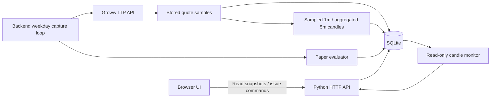

# Architecture and source map

Reviewed: 2 November 2026. This is the implemented local architecture.

## Runtime flow

The API and capture thread run in the same Python process. SQLite connections
are created per request/capture cycle. There is no installed Redis bus,
PostgreSQL service, FastAPI service, WebSocket feed, or cloud service in this
implementation, regardless of prototype labels on some screens.

## Modules

| File | Responsibility |
| --- | --- |
| `work/api_server.py` | Static files, JSON routes, runtime token/status, capture thread, latest runtime evaluation. |
| `work/sqlite_app.py` | Schema, settings, CSV import, aggregation, strategy replay, paper fills/exits, order approval, CLI. |
| `work/live_market.py` | Groww LTP storage, receipt-minute sampled candles, aggregation calls, paper-evaluation guards. |
| `work/candle_monitor.py` | Non-mutating today's-market snapshot, forming candle, counts, and partial gap statistics. |
| `work/premarket.py` | Daily context persistence and sampled-price rules inference. |
| `work/order_manager.py` | Local idempotent intent creation, cancellation, uncertain checks, paper kill switch. |
| `work/groww_adapter.py` | Groww REST translation, authentication headers, errors, guarded order methods. |
| `work/groww_reconciliation.py` | Read-only broker order/trade observations and matching. |
| `work/validation.py` | Simple execution-cost adjustment, development/OOS summaries, sensitivity, release checks. |
| `work/readiness.py` | Combines database validation with external readiness flags. |
| `work/backtest.py`, `work/strategy_compare.py` | Earlier replay/comparison utilities; the current API uses `sqlite_app.backtest`. |
| `work/app/app.js` | Navigation, primary screens, API actions, configuration, and paper order controls. |
| `work/app/candles.js` | Capture monitor, SVG candles, symbols, five-second read-only refresh. |
| `work/app/styles.css`, `theme.css`, `candles.css` | Layout, theme, and candle monitor presentation. |
| `work/test_*.py` | Python regression checks. |

## Storage and timestamp conventions

| Record group | Tables |
| --- | --- |
| Strategy and configuration | `strategy_versions`, `session_settings`, `premarket_context` |
| Raw capture and candles | `live_quotes`, `live_quote_ticks`, `candles` |
| Decisions | `sessions`, `signals`, `risk_decisions` |
| Paper execution | `order_intents`, `fills`, `trades` |
| Observability | `audit_events`, `broker_events` |

Receipt/audit timestamps generally use UTC with `Z`. Captured tick-minute and
stored candle timestamps are currently timezone-naive India-local strings.
The candle-monitor response adds `+05:30` for chart timestamps. Do not treat
these representations as interchangeable; central timestamp normalization is
remaining work, especially for the 5m boundary mismatch.

The configured SQLite path defaults to `work/breakout.db`. WAL mode is enabled.
Token data and latest evaluation snapshots are process memory rather than
durable session recovery state. The adapter can also read server environment
configuration; runtime capture still depends on its verified runtime token.

## API inventory

| Method | Paths | Purpose |
| --- | --- | --- |
| GET | `/api/health` | Basic server health, not complete trading readiness. |
| GET | `/api/live-data/status` | Runtime verification, scheduler metadata, stored quotes. `signals_ready` here is currently fixed false. |
| GET | `/api/live-data/candles?symbol=RELIANCE` | Read-only candle snapshot and latest runtime evaluation. |
| GET | `/api/summary`, `/api/signals`, `/api/orders` | Stored strategy/paper state; symbol defaults to NIFTY50. |
| GET | `/api/session/config`, `/api/premarket`, `/api/readiness`, `/api/reconcile` | Configuration, context, readiness, local order checks. |
| GET | `/api/brokers/groww` | Configuration and a read-only verification request when a runtime token exists; it is not merely a cached read. |
| POST | `/api/brokers/groww/configure`, `/api/brokers/groww/verify` | Receive and verify a daily token. |
| POST | `/api/live-data/poll`, `/api/live-data/evaluate` | Explicit quote capture and paper evaluation. |
| POST | `/api/premarket`, `/api/premarket/refresh` | Save context or capture quotes and infer daily context. |
| POST | `/api/session/config`, `/api/session/run`, `/api/backtest` | Persist capital/risk, request a session, or replay stored data. |
| POST | `/api/orders/approve`, `/api/orders/reject`, `/api/orders/approve-all`, `/api/orders/reject-all` | SQLite pending-order actions. |
| POST | `/api/brokers/groww/reconcile`, `/api/kill-switch` | Broker read/import and local cancellation behavior. |

## Boundaries for future deployment

The current API has no owner authentication and sends permissive CORS headers.
Keep it bound to loopback as delivered. Remote/mobile/cloud access requires an
explicit access-control design, authenticated HTTPS, credential handling,
service supervision, and recovery verification. Publishing source to GitHub
does not deploy a web application or transfer the local database.
